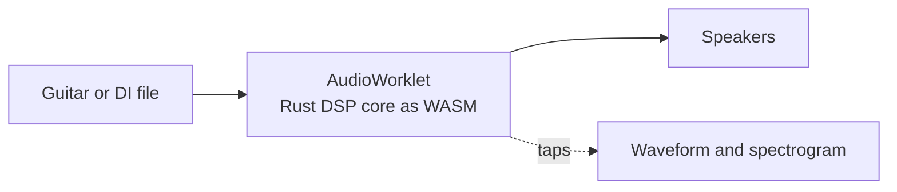

# v-guitar-rig

Plug in your guitar, play through virtual pedals and amps in the browser, and watch the signal change at every stage. Effects are modelled from real parts (diodes today; transistors, tubes and ICs next), and you can describe a tone to your own LLM through MCP or CLI to build it.


> **Early stage.** A diode clipper is solved from its netlist in real time, with a pedalboard editor, six more pedals, a daemon, board files and an offline renderer behind it. MCP and amp sims are planned; see [docs/SLICES.md](docs/SLICES.md).



## Quick start

You need Node 24+, [pnpm](https://pnpm.io), and [Rust via rustup](https://rustup.rs).

```bash
git clone https://github.com/leejianrong/v-guitar-rig.git
cd v-guitar-rig
make install   # JS deps and the pinned Rust toolchain
make demo      # builds everything, serves the UI and daemon, prints the URL
```

Use Chrome or another Chromium browser.

To run the daemon in Docker instead (it serves the same UI, keeps your rig files in `./rig`, and publishes on `127.0.0.1:7878` only):

```bash
make up                       # open http://127.0.0.1:7878
```

Live audio always runs in your browser; Docker cannot reach a Windows sound card.

## Usage

1. Choose **Test tone** to hear the board with no hardware, or **Guitar input** to play through your audio interface, then press **Start audio** (and **Stop audio** to end it). Keep your volume low at first; **Output volume** sits after the limiter.
2. Build a board: click a pedal on the shelf at the left to add it, drag a pedal by its name (or use the arrows) to reorder, turn a knob by dragging it, or click it and use the mouse wheel (arrow keys and double-click to reset also work), and press a footswitch to bypass. Click a jack on a cable to see the waveform and spectrogram at that point in the chain. Click a pedal to inspect it: before/after spectrum, input and output level, and measured transfer curve and frequency response, plus echo taps for the delay and the sweep for the chorus.
3. For offline rendering, build the CLI and render the default board through the same DSP core:
   ```bash
   pnpm --filter @rig/daemon build
   node packages/daemon/dist/rig.mjs render --board default --seconds 5 --out out.wav
   ```
   The browser worklet and this renderer agree to within 1e-5 (measured: exactly equal on a 5 s clip).
4. To add a generated pedal, write its source (the format is documented at the top of `packages/dsp-host/src/compile.ts`; ADR-0004 describes the sandbox it runs in) and `rig module new my-pedal.js` against the running daemon; it is checked in a sandbox before it is kept, and `rig module list` / `rig module check ID` show and re-check what is stored. Stored modules render offline and return descriptors (`rig render --json`), and play in the browser as soon as they are stored.
5. To let your own LLM do this, point an MCP client at `node packages/daemon/dist/rig.mjs mcp` (stdio; set `RIG_URL` and `RIG_TOKEN`, or `--rig-dir` to read the token). It offers tools to list, add and check modules, get and set boards and presets, write riffs, and render with descriptors, plus prompts that explain the module format and the loop.
6. The amp comes as a **Valve Preamp** and a **Power Amp** (and the one-piece Valve Amp). Put both on the board and they draw as one amp head; pedals between them are its effects loop, so delay, reverb and chorus (which the shelf puts there for you) are pushed through the power stage and speaker as in a real rig. The Speaker Cab is drawn as a cabinet.
7. To test a tone on a riff instead of the test tone, choose **Virtual guitar (riff)** as the source: a plucked-string guitar plays the riff you pick, and a tab editor under the board lets you click a cell and type frets (`h` hammer-on, `p` pull-off, `s` slide, `b` bend, `m` palm mute) while it plays. Save a riff from the editor, or choose **Audio file** as the source to play a recording of your own (looped, stereo mixed to mono). Riffs can also be added with `rig riff new FILE.json`, or ASCII tab with `rig riff new lick.txt --id lick --bpm 100`; The **Level** strip shows the chain output's loudness (momentary, short-term and integrated LUFS to ITU-R BS.1770, and peak); every shipped preset is levelled to about -16 LUFS on the shipped riffs. `rig render --riff ID` and the MCP `render` tool (which also return LUFS) play a riff through a board offline, and `set_riff` lets an LLM write one.
8. For round-trip latency, connect your interface output to an input with a cable and press **Measure loopback latency**.

The measured CPU headroom on the author's machine is about 13x per 128-frame block; hardware latency numbers are not recorded yet ([docs/hardware-checks.md](docs/hardware-checks.md)).

## Documentation

- [docs/PLAN.md](docs/PLAN.md): what is being built and why
- [docs/SLICES.md](docs/SLICES.md): build order and acceptance tests
- [docs/adr/](docs/adr/): architecture decisions

## Contributing

See [CONTRIBUTING.md](CONTRIBUTING.md).

## License

[Apache-2.0](LICENSE)
