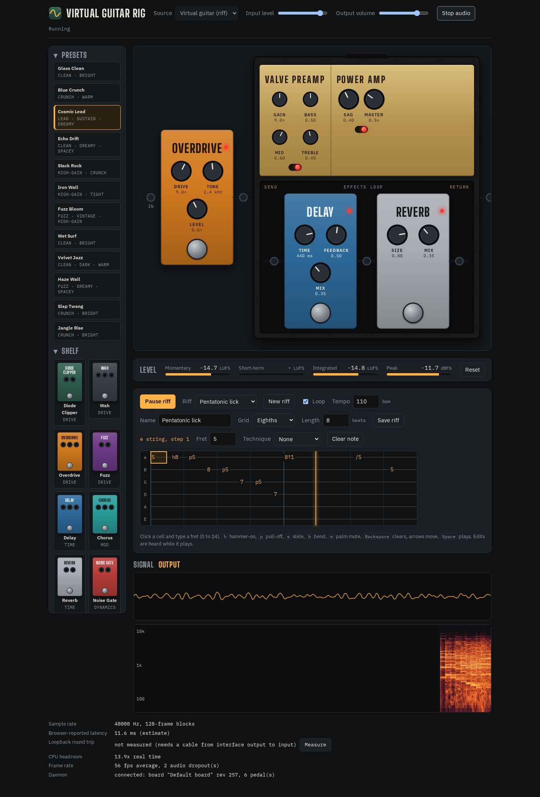
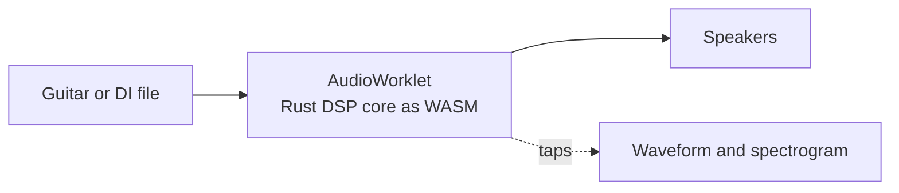

# v-guitar-rig

Plug in your guitar, play through virtual pedals and amps in the browser, and watch the signal change at every stage. Effects are modelled from real parts (diodes today; transistors, tubes and ICs next), and you can describe a tone to your own LLM through MCP or CLI to build it.



> **Early stage.** One pedal works end to end: a diode clipper solved from its netlist in real time. The board UI, daemon, MCP/CLI and amp sims are planned; see [docs/SLICES.md](docs/SLICES.md).



## Quick start

You need Node 24+, [pnpm](https://pnpm.io), and [Rust via rustup](https://rustup.rs).

```bash
git clone https://github.com/leejianrong/v-guitar-rig.git
cd v-guitar-rig
make install                  # JS deps and the pinned Rust toolchain
make wasm                     # build the DSP core
pnpm --filter @rig/web dev    # open http://127.0.0.1:5173
```

Use Chrome or another Chromium browser.

## Usage

1. Choose **Test tone** to hear the pedal with no hardware, or **Guitar input** to play through your audio interface, then press **Start audio**. Keep your volume low at first.
2. Toggle **Diode clipper** to compare the clean and clipped signal, and watch the harmonics appear in the output spectrogram.
3. For round-trip latency, connect your interface output to an input with a cable and press **Measure loopback latency**.

The measured CPU headroom on the author's machine is about 13x per 128-frame block; hardware latency numbers are not recorded yet ([docs/hardware-checks.md](docs/hardware-checks.md)).

## Documentation

- [docs/PLAN.md](docs/PLAN.md): what is being built and why
- [docs/SLICES.md](docs/SLICES.md): build order and acceptance tests
- [docs/adr/](docs/adr/): architecture decisions

## Contributing

See [CONTRIBUTING.md](CONTRIBUTING.md).

## License

[Apache-2.0](LICENSE)
