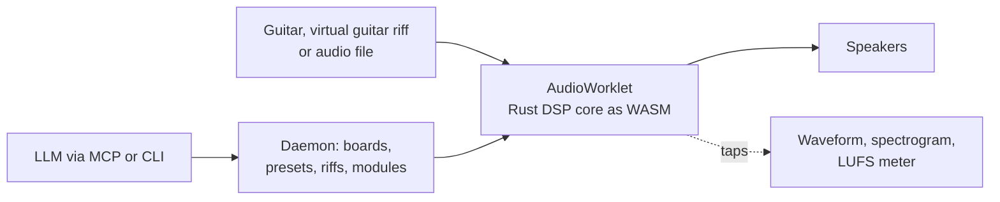

# v-guitar-rig

Plug in your guitar, play through virtual pedals and amps in the browser, and watch the signal change at every stage. Effects are modelled from real parts (diodes today; transistors, tubes and ICs next), and you can describe a tone to your own LLM through MCP or CLI to build it.


> **Early stage.** Working today: a circuit-solved diode clipper, seven more pedals (wah included), a valve preamp and power amp with an effects loop, a speaker cab, twelve presets, a plucked-string virtual guitar with a tab editor, a LUFS meter, a daemon with CLI and MCP, and an offline renderer. Not built yet: tubes and transistors solved from netlists, tone matching from a track, the digital twin. See [docs/SLICES.md](docs/SLICES.md).



## Quick start

You need Node 24+, [pnpm](https://pnpm.io), and [Rust via rustup](https://rustup.rs).

```bash
git clone https://github.com/leejianrong/v-guitar-rig.git
cd v-guitar-rig
make install   # JS deps and the pinned Rust toolchain
make demo      # builds everything, serves the UI and daemon, prints the URL
```

Use Chrome or another Chromium browser.

To run the daemon in Docker instead (it serves the same UI, keeps your rig files in `./rig`, and publishes on `127.0.0.1:7878` only):

```bash
make up                       # open http://127.0.0.1:7878
```

Live audio always runs in your browser; Docker cannot reach a Windows sound card.

## Usage

1. **Play.** Pick a source (**Test tone**, **Guitar input**, **Virtual guitar (riff)** or **Audio file**) and press **Start audio**. Keep the volume low at first; **Output volume** sits after the limiter.
2. **Build a board.** Click a pedal on the shelf to add it, or load a preset. Drag by the name to reorder, drag or scroll a knob, press a footswitch to bypass. Click a jack to see the waveform and spectrogram there, or a pedal to see its before/after spectrum and measured curves.
3. **Amp and loop.** Put the **Valve Preamp** and **Power Amp** on the board and they draw as one head. Pedals between them sit in the effects loop; the shelf puts delay, reverb and chorus there for you. The **Wah** goes in front, with a treadle you drag.
4. **Test a tone on a riff.** The virtual guitar plays a riff you pick; edit it in the tab editor under the board while it plays (`h` `p` `s` `b` `m` for hammer-on, pull-off, slide, bend, palm mute). The **Level** strip reads LUFS (BS.1770) and peak; the shipped presets are levelled to about -16 LUFS on the shipped riffs.
5. **Render offline** through the same DSP core:
   ```bash
   pnpm --filter @rig/daemon build
   node packages/daemon/dist/rig.mjs render --board default --riff pentatonic-lick --out out.wav
   ```
   It prints the LUFS. The browser worklet and this renderer agree to within 1e-5.
6. **Let your LLM do it.** Point an MCP client at `node packages/daemon/dist/rig.mjs mcp` (stdio; set `RIG_URL` and `RIG_TOKEN`, or `--rig-dir`). Tools list, add and check modules, get and set boards, presets and riffs, and render. Riffs also come in with `rig riff new lick.txt --id lick --bpm 100` (ASCII tab), and a new pedal with `rig module new my-pedal.js` (format at the top of `packages/dsp-host/src/compile.ts`; it runs in a sandbox, see ADR-0004).

CPU headroom is about 13x per 128-frame block on the author's machine. Hardware latency is not recorded yet ([docs/hardware-checks.md](docs/hardware-checks.md)); to measure it, loop an interface output to an input and press **Measure**.

## Documentation

- [docs/PLAN.md](docs/PLAN.md): what is being built and why
- [docs/SLICES.md](docs/SLICES.md): build order and acceptance tests
- [docs/adr/](docs/adr/): architecture decisions

## Contributing

See [CONTRIBUTING.md](CONTRIBUTING.md).

## License

[Apache-2.0](LICENSE)
